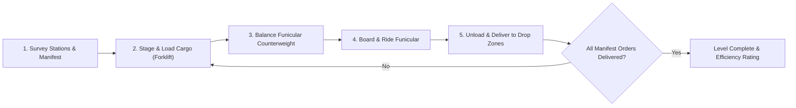

# Forklifts and Funiculars — Game Design Document (GDD)

> **Document Status:** Draft v0.2 (3/4 Overhead · Web-First Requirements)

---

## 1. High Concept & Vision

### 1.1 Elevator Pitch
**Forklifts and Funiculars** is a **3/4 overhead**, 3D stylized low-poly physics logistics and delivery puzzle game built for **instant play in the browser**. Set in a steep terraced mountain depot town, players drive a nimble industrial forklift to load pallets, ride directly aboard historic cable funiculars, and solve tactile counterweight puzzles between cable-linked cars to move cargo safely between elevations.

### 1.2 Core Design Pillars
1. **Tactile Forklift Feel:** Authentic rear-wheel steering, smooth hydraulic lift/tilt, satisfying pallet seating, and forgiving physics that feel weighty without being frustrating—with crisp overhead alignment cues so lifting and stacking from a 3/4 view feels effortless.
2. **Real Counterweight Logistics:** Two funicular cars share one continuous haul cable—when Car A rises, Car B descends. Moving heavy loads requires balancing mass across both cars using cargo, stone ballast, or even the forklift itself.
3. **Ride-On Continuity:** No cutscenes or teleporting between decks. Drive straight onto the funicular, drop the wheel chocks, ring the departure bell, and enjoy the scenic ride between stations.
4. **Readable Low-Poly Dioramas (Web-Native):** Crisp stylized 3D environments engineered for fast browser loading and high readability—stations, cable tension gauges, weighbridges, and delivery zones communicate puzzle state visually rather than through walls of text.

### 1.3 Target Audience & Tone
- **Tone:** Charming, clever, sun-drenched industrial cozy—inviting experimentation rather than punishing timers, immediately accessible via a URL with zero install friction.
- **Reference Touchstones:** *Captain Toad: Treasure Tracker* (compact readable 3/4 3D dioramas), *Art of Rally* / *Overcooked* (clean 3/4 overhead vehicle and spatial clarity), *Poly Bridge* (approachable physics problem-solving), *A Short Hike* (stylized low-poly warmth).

---

## 2. Core Gameplay Loop

### Level Flow
1. **Survey:** The player inspects the terraced level (using the overview camera) to see cargo spawn bays, delivery zones, ballast stockpiles, and the funicular's counterweight limit.
2. **Load & Stage:** Using the forklift, the player picks up pallets, checks weights on station weighbridges, and arranges cargo onto the funicular car deck (or leaves room to ride aboard).
3. **Balance:** Before departure, the funicular verifies that the mass difference between Car A and Car B stays within the haul motor's tolerance (`|Mass_A - Mass_B| <= Delta_Max`).
4. **Ride / Dispatch:** The player either boards the car with the forklift and triggers departure, or dispatches the cars remotely to send cargo/counterweights to the opposite station.
5. **Unload & Complete:** At the destination station, safety gates lower flush to the dock, the player drives off, places cargo into color- and icon-coded delivery bays, and repeats until the manifest is fulfilled.

---

## 3. Functional Requirements

### 3.1 Forklift Mechanics (`FR-FORK`)

| ID | Requirement | Priority | Acceptance Criteria |
| :--- | :--- | :--- | :--- |
| **FR-FORK-01** | **Rear-Wheel Steering & Drivetrain** | Must | Forklift steers from the rear axle with tight turning radius, smooth acceleration, instant reverse, and a dedicated low-speed precision/crawl modifier. |
| **FR-FORK-02** | **Hydraulic Mast Lift** | Must | Forks smoothly raise and lower between ground flush (`0.0m`) and double-stack height (at least `2.5` pallet heights) with consistent speed under load. |
| **FR-FORK-03** | **Mast Tilt** | Must | Mast tilts forward (for sliding forks cleanly into/out of pallets on slopes) and backward (to cradle cargo against the backrest during transit and ramps). |
| **FR-FORK-04** | **Fork-Pocket Alignment Assist** | Should | Optional toggleable gentle alignment/friction assist when forks enter pallet slots, preventing jittery collisions while preserving manual skill. |
| **FR-FORK-05** | **Stability & Tipping Physics** | Must | Carrying heavy cargo with mast raised high or turning sharply shifts center of mass and can tip the forklift; a subtle visual/audio stability cue warns the player before rollover. |
| **FR-FORK-06** | **Self-Recovery & Reset** | Must | If tipped over or wedged, the player can hold an upright/recovery button to gently right the forklift at the nearest safe dock spot without losing whole-level progress. |
| **FR-FORK-07** | **Parking Brake / Deck Lock** | Must | Engaging the brake while parked inside a funicular car locks the forklift chassis safely to the moving deck. |
| **FR-FORK-08** | **Horn & Station Bell Signal** | Should | Pressing horn triggers a friendly industrial beep (and can trigger funicular departure when docked at a call switch). |

### 3.2 Cargo & Pallet System (`FR-CARGO`)

| ID | Requirement | Priority | Acceptance Criteria |
| :--- | :--- | :--- | :--- |
| **FR-CARGO-01** | **Standardized Pallet Interface** | Must | All liftable cargo sits on readable pallets with uniform fork-entry channels; visually distinct sizes (Standard `1x1`, Wide `2x1`). |
| **FR-CARGO-02** | **Distinct Mass Classes** | Must | Cargo has clear, predictable integer mass units (e.g., `1t` Light, `2t` Medium, `4t` Heavy, `6t` Industrial) displayed via stenciled markings and readable on weighbridges. |
| **FR-CARGO-03** | **Stacking Support** | Must | Flat-topped crates support stable 2-high stacking without physics explosions or sliding drift. |
| **FR-CARGO-04** | **Ballast Blocks** | Must | Reusable neutral stone/steel counterweight pallets (`1t`, `2t`, `4t`) available at stations solely for balancing funicular runs. |
| **FR-CARGO-05** | **Fragile Cargo** | Should | Certain deliveries (e.g., alpine glass, vineyard crates) shatter if dropped from height or subjected to high impact; broken items cleanly respawn at their origin dock (incrementing damage counter). |
| **FR-CARGO-06** | **Specialty / Offset Loads** | Could | Advanced chapters introduce off-center heavy loads (requiring careful fork placement), oversized beams (occupying full car length), or rolling drums (requiring back-tilt). |

### 3.3 Funicular & Counterweight System (`FR-FUNIC`)

| ID | Requirement | Priority | Acceptance Criteria |
| :--- | :--- | :--- | :--- |
| **FR-FUNIC-01** | **Linked Twin-Car Kinematics** | Must | Car A and Car B are mechanically coupled by a shared cable (`progress_B = 1.0 - progress_A`), crossing cleanly at a midpoint passing loop on sloped track splines. |
| **FR-FUNIC-02** | **Level Car Decks on Slopes** | Must | Each funicular car deck remains horizontally level regardless of incline pitch (`15°–40°`), with realistic wedge-shaped undercarriages matching track grade. |
| **FR-FUNIC-03** | **Ride-On Forklift Transport** | Must | Player can drive the forklift smoothly over flush dock ramps onto a car deck, engage deck lock, ride in real time with zero jitter/clipping, and drive off at the target station. |
| **FR-FUNIC-04** | **Counterweight Balance Rule** | Must | Funicular calculates total mass on Car A (`M_A`) and Car B (`M_B`), including cargo, ballast, and any onboard forklift (`M_forklift`, e.g., `2t`). Departure is permitted only when `|M_A - M_B| <= Delta_Max` and neither car exceeds its structural `Max_Deck_Load`. |
| **FR-FUNIC-05** | **Clear Overload Feedback** | Must | Attempting to depart while unbalanced produces immediate diegetic feedback: haul winch strains, red overload lamp flashes, and the cable-house dial shows which car is too heavy and by how many tons. |
| **FR-FUNIC-06** | **Remote Dispatch & Multi-Forklift** | Should | Stations feature a call/dispatch lever (or bumper switch) so the player can send a loaded car up/down without riding it—enabling counterweight swaps or handing cargo to a second forklift stationed at another tier. |
| **FR-FUNIC-07** | **Safety Gates & Dock Ramps** | Must | Automated safety barriers close before departure and fold into smooth bridge ramps when docked, preventing accidental roll-offs mid-transit. |
| **FR-FUNIC-08** | **Intermediate Stops & Chained Lines** | Should | Mid-campaign levels support a midpoint transfer station; late-campaign levels link two separate funicular lines at a shared interchange terrace. |
| **FR-FUNIC-09** | **Water-Ballast Tanks (Advanced)** | Could | Late-game funiculars include fillable water ballast tanks (inspired by real historical water-balanced funiculars) that fill at the upper station and drain at the lower station. |

### 3.4 Stations, Environment & Puzzles (`FR-ENV`)

| ID | Requirement | Priority | Acceptance Criteria |
| :--- | :--- | :--- | :--- |
| **FR-ENV-01** | **Weighbridges** | Must | Every station with balance puzzles includes a drive-over weighbridge with a large, readable world-space dial/display showing live total mass (forklift + held cargo, or placed pallet). |
| **FR-ENV-02** | **Delivery Drop Zones** | Must | Ground-painted zones with matching color + symbol icons (e.g., Crate, Barrel, Gear) validate cargo presence, uprightness, and intactness; chime and light up when satisfied. |
| **FR-ENV-03** | **Trackside & Station Obstacles** | Should | Tight loading alleys, narrow bridges, elevation ramps, revolving turntables (to rotate wide loads), and low clearances (requiring lowered masts) create spatial forklift puzzles. |
| **FR-ENV-04** | **Checkpoint / Undo Trip** | Should | Players can rewind to the previous docked state ("Undo Last Run") or full-reset the level in one action so experimenting with counterweight solutions feels effortless. |

### 3.5 Progression, Modes & Scoring (`FR-PROG`)

| ID | Requirement | Priority | Acceptance Criteria |
| :--- | :--- | :--- | :--- |
| **FR-PROG-01** | **Chapter-Based Campaign** | Must | Linear-with-branching level select map showing the mountain transit network lighting up as stations are completed. |
| **FR-PROG-02** | **Non-Blocking Mastery Stars** | Should | Completing all manifest deliveries unlocks the next level. Optional bonus badges reward: (1) Zero Cargo Damage, (2) Par Funicular Trips, and (3) Clean Parking / Par Time. |
| **FR-PROG-03** | **Cozy Sandbox / Free-Drive Mode** | Should | Unlockable (or immediately accessible) multi-tier depot sandbox with infinite cargo spawner, scenic funicular loop, and zero fail states for relaxed play. |

---

## 4. Campaign Progression Outline

| Chapter | Setting | Mechanics Introduced | Sample Puzzle Concept |
| :--- | :--- | :--- | :--- |
| **Ch. 1: Valley Depot** | Sunlit coastal base station | Forklift driving, mast lift/tilt, stacking, driving onto a single balanced funicular | Load 2 pallets, ride up with the forklift, unload at Upper Market. |
| **Ch. 2: The Counterweight** | Twin-car limestone quarry | Linked Car A / Car B balance (`Delta_Max`), weighbridges, ballast blocks, forklift mass as counterweight | Heavy `4t` machinery must go up, but motor limit is `2t`—stage ballast on the upper car or counterbalance with the forklift. |
| **Ch. 3: Passing Loop** | Mid-mountain vineyard & village | Mid-slope transfer station, fragile cargo, remote dispatch, two forklifts on separate tiers | Relay fragile wine pallets from Valley to Mid-Station while descending empty casks act as counterweight. |
| **Ch. 4: Alpine Switchbacks** | High-altitude dual-line interchange | Chained funicular lines, turntables, oversized beams, water-ballast tanks | Coordinate an upper and lower funicular network across three terraces to deliver an observatory dome. |

---

## 5. Camera, Controls & UI/UX Requirements

### 5.1 Camera Modes (`UX-CAM`)
- **3/4 Overhead Follow (Default):** Fixed-pitch angled 3/4 perspective (`~45°–55°` pitch, mild telephoto/low-FOV `30°–40°` for crisp diorama proportions) that smoothly tracks the forklift with slight look-ahead in the direction of travel.
  - **Stepped Rotation & Zoom:** Players can rotate the camera in crisp `45°` or `90°` increments (or smooth right-stick/mouse-drag orbit) to peek behind stacked crates, funicular arches, or cliff walls, plus smooth zoom in/out.
  - **Overhead Depth & Fork-Alignment Aids (`UX-CAM-DEPTH`):** Because judging vertical fork height from a 3/4 overhead angle can be tricky, the game MUST render subtle, crisp world-space alignment cues:
    - A soft projected ground shadow / footprint reticle directly beneath carried pallets when lifted off the floor.
    - Subtle highlight guides on pallet fork pockets when the forks are aligned within entry height and angle.
    - Automatic gentle cutaway/transparency fade on any tall station roofs or foreground rock pillars that would otherwise occlude the forklift.
- **Diorama Overview (Zoom-Out Toggle):** Smoothly pulls the 3/4 overhead camera back along the same angle to frame the entire slope—both stations, the passing loop, and both funicular cars—so players can plan counterweight moves without a disorienting perspective shift.
- **Scenic Ride Tracking:** During funicular travel, the 3/4 camera smoothly glides alongside the ascending/descending car and slightly widens near the midpoint passing loop so both crossing cars stay framed.

### 5.2 Control Scheme (`UX-CTRL`)
Full parity between **Keyboard + Mouse** and **Browser Gamepad API**, with remappable inputs:

| Action | Keyboard / Mouse | Gamepad |
| :--- | :--- | :--- |
| Steer (Vehicle-Relative Rear Steer) | `A` / `D` | Left Stick X |
| Throttle / Reverse | `W` / `S` | Right Trigger / Left Trigger |
| Precision Crawl Mode | Hold `Left Shift` | Hold `LB` |
| Mast Raise / Lower | `R` / `F` (or `Up` / `Down`) | Right Stick Vertical (or `Y` / `A`) |
| Mast Tilt Back / Forward | `Q` / `E` | D-Pad Up / Down |
| Parking Brake / Deck Lock | `Space` | `B` |
| Horn / Call Funicular | `H` | `X` |
| Interact (Station Lever / Dispatch) | `Enter` / `G` | `RB` |
| Rotate 3/4 Camera (`90°` step / orbit) | `Z` / `C` or Right-Click Drag | `LB` + Right Stick / D-Pad Left-Right |
| Zoom / Toggle Diorama Overview | Mouse Wheel / `Tab` | `Select` / `L3` |
| Upright / Undo Trip | Hold `Backspace` | Hold `Start` / Menu |

> **3/4 Overhead Steering Note:** Default steering uses authentic vehicle-relative rear-wheel controls (`W/S` throttle/reverse, `A/D` steer) for realistic forklift feel; an optional accessibility toggle may offer camera-relative directional steering assist if playtesting shows casual web players want it.

### 5.3 Diegetic UI & HUD (`UX-UI`)
- **Minimal HUD:** Keep screen space clean—only show a collapsible Manifest checklist (corner) and subtle contextual button prompts when near switches or loading decks.
- **Diegetic Indicators:**
  - **Counterweight Scale:** Large mechanical twin-needle balance dial mounted above each funicular station arch, showing `M_A`, `M_B`, and a green/red safe-differential arc.
  - **Cargo Weight:** Crisp painted tonnage stencils (`1T`, `2T`, `4T`) and distinct visual silhouettes/colors.
  - **Delivery Progress:** Physical green check-lamps / flags raising at completed drop zones.

---

## 6. Art & Audio Direction

### 6.1 Visual Direction
- **Style:** Low-poly stylized 3D with flat/subtle-gradient shading, soft ambient occlusion, crisp shadows, and hand-crafted diorama proportions (chunky readable silhouettes).
- **Palette:** High-contrast industrial hero colors (safety yellow/orange forklift, heritage red/cream funicular cars) against natural alpine tones (pine green, warm limestone, terracotta roofs, clear sky blue).
- **Readability:** Interactive objects (pallets, levers, ramps, ballast) always have higher saturation and distinct silhouettes than background scenery.

### 6.2 Audio Direction
- **Forklift Foley:** Soft electric motor whine (or charming chugging diesel—TBD), distinct hydraulic hiss when lifting/tilting, reverse warning chime (pleasant, non-fatiguing), rubber tire squeak on concrete.
- **Funicular Foley:** Brass departure bell, deep winch motor hum that subtly pitches down under heavy load, rhythmic metallic clack of cable sheaves, satisfying clunk when deck ramps lock into place.
- **Ambience & Music:** Light acoustic/marimba/accordion alpine-cozy soundtrack that breathes dynamically—quiet during careful stacking, uplifting while gliding up the mountainside.

---

## 7. Technical & Web Deployment Requirements

### 7.1 Web Platform & Browser Requirements (`NFR-WEB`)
- **Target Runtimes:** Modern desktop browsers (Chrome/Edge, Firefox, Safari) using **WebGL2** as the baseline renderer (with progressive **WebGPU** support where available).
- **Static Hosting Friendly:** Deployable as a pure static bundle (HTML/JS/WASM/GLB) to static hosts (e.g., Cloudflare Pages, GitHub Pages, or self-hosted homelab nginx/Traefik) with zero required backend server for single-player gameplay.
  - Prefer single-threaded WASM physics by default so the game does **not** strictly require `Cross-Origin-Opener-Policy` / `Cross-Origin-Embedder-Policy` (`SharedArrayBuffer`) headers unless explicitly needed.
- **Fast Cold Load & Asset Budget:**
  - Initial playable Vertical Slice payload target: **`< 15 MB` gzipped/brotli** (ideally `< 8 MB` with procedural/palette-textured low-poly GLB meshes).
  - First interactive frame in `< 3–5s` on a standard broadband connection, with a clean diegetic loading bar.
- **Browser Ergonomics:**
  - Responsive full-viewport canvas (`16:9`, ultrawide, and windowed resize) with crisp DPR scaling (capped at `2.0` to protect integrated GPU frame rates) and one-click Fullscreen toggle.
  - Graceful **Web Audio API** unlock on first user interaction, plus automatic pause/mute when the browser tab loses focus (`visibilitychange`).
  - Native **HTML5 Gamepad API** hot-plug detection alongside keyboard/mouse.

### 7.2 Physics & Simulation (`NFR-PHYS`)
- **Fixed Timestep:** Physics simulation must run on a deterministic fixed timestep (`>= 60 Hz`, ideally `120 Hz` sub-stepping in WASM rigid-body engine) decoupled from `requestAnimationFrame` display refresh rate (`60/120/144 Hz`).
- **Stable Moving-Platform Transport:** When a funicular moves, locked forklifts and seated pallets must inherit platform transform cleanly (via kinematic parenting, rigid constraints, or coupled solver frames) with **zero clipping, phantom drift, or tunneling** even at steep track grades.
- **No Jittery Stacks:** Rigid-body solver configuration must support 2–3 stacked pallets on a moving forklift or funicular car without micro-bouncing.
- **Reliable Trigger Volumes:** Station docking zones, weighbridges, and drop zones must debounce weight readings smoothly so values don't flicker.

### 7.3 Performance & Quality (`NFR-PERF`)
- **Frame Rate:** Smooth `60 FPS` target at `1080p` in desktop browsers on modest integrated/mid-range GPUs (low draw-call count via instanced/merged low-poly meshes and shared color-palette materials).
- **Fast Restarts:** Level reset and "Undo Last Run" must complete in `< 0.5s` in-memory without re-fetching assets or reloading static level geometry.

### 7.4 Accessibility (`NFR-A11Y`)
- **Colorblind-Safe Visuals:** Every cargo category and delivery zone uses **both** distinct colors and unmistakable geometric icons/patterns.
- **Assist Toggles:** Optional toggles for Fork Alignment Assist, Anti-Tip Stabilizer, Camera-Relative Steering Assist, and Simplified Counterweight Math display (shows exact numeric `+/- tons needed`).
- **Comfort:** Camera shake toggle, smooth zoom/rotation damping, and adjustable mouse/stick sensitivity.

### 7.5 Save Data (`NFR-SAVE`)
- Client-side browser persistence via `localStorage` / `IndexedDB` storing unlocked chapters/levels, earned mastery badges, control bindings, and accessibility settings, with optional JSON save export/import so progress can move between browsers.

---

## 8. Minimum Viable Prototype (Vertical Slice) Scope

To validate core game feel in the browser before full production, the initial vertical slice will contain **only**:

1. **1 Playable Forklift:** Rear-wheel steering, mast lift, mast tilt, parking brake/deck lock, horn, upright recovery, plus overhead pallet alignment reticle.
2. **1 Twin-Car Funicular Track:** Lower Station + Upper Station, midpoint passing loop, automated dock ramps, counterweight balance check (`Delta_Max = 2t`), diegetic balance gauge, onboard departure button + remote station lever.
3. **4 Object Types:** Light crate (`1t`), Medium crate (`2t`), Heavy crate (`4t`), Ballast block (`2t`), plus 1 drive-over weighbridge per station.
4. **3 Handcrafted Levels:**
   - **Level 1 (First Ride):** Pick up two `1t` crates, load onto Car A, drive forklift onto Car A, ride to Upper Station, deliver both.
   - **Level 2 (Heavy Counterweight):** Deliver one `4t` heavy crate uphill (`Delta_Max = 2t`, forklift = `2t`). Requires balancing Car B with ballast or staging trips.
   - **Level 3 (Two-Way Swap):** Deliver a `4t` crate uphill AND a `2t` fragile crate downhill within a par trip count, introducing multi-step counterweight planning.
5. **Core 3/4 Overhead Camera:** 3/4 overhead follow with `90°` stepped rotation, zoom, foreground occlusion fade, and Diorama Overview zoom-out toggle.
6. **Web Build Pipeline:** Static production build playable locally and directly deployable to a static web host.

### Vertical Slice Exit Criteria
- Loads cleanly in modern Chromium/Firefox/Safari in `< 5s` at a steady `60 FPS`.
- Driving, aligning forks from the 3/4 overhead view, and lifting pallets feels intuitive within 60 seconds with zero tutorial walls.
- Forklift + stacked pallets ride smoothly up and down the funicular with zero physics glitches across 20 consecutive test runs.
- Counterweight puzzles feel like genuine "aha!" moments rather than tedious arithmetic.

---

## 9. Open Design Decisions (For Next Iteration)

1. **Web Tech Stack / Engine Selection:**
   - **Three.js + Rapier3D (TypeScript + Vite):** Tiny bundle (`< 2 MB` core), rock-solid Rust/WASM rigid-body physics, instant dev iteration, trivial static hosting, no `SharedArrayBuffer` headaches.
   - **Babylon.js + Havok/Rapier:** Batteries-included 3D web engine with built-in Havok WASM physics and inspector tools, slightly heavier bundle.
   - **Godot 4 (Web/HTML5 Export):** Visual scene editor and built-in tooling, though WebGL2/WASM export bundles are larger (`~20–35 MB`) and multi-threaded web exports require COOP/COEP headers.
2. **Forklift Mass Representation:** Should the forklift always count toward funicular counterweight (`2t`, enabling clever "use yourself as ballast" puzzles), or should a lightweight "mini-jack" mode exist? *(Current GDD assumes forklift = `2t` and counts!)*
3. **Multiplayer / Co-op:** Keep strictly single-player (with optional switching between 2 forklifts in Chapter 3+), or reserve room in architecture for 2-player local co-op (shared keyboard/gamepad, one forklift per station)?
4. **Drivetrain Flavor:** Crisp quiet electric forklift vs. charming puttering vintage diesel forklift?
